# TimeDetective

**Is this place really changing, or does the chart just look dramatic? TimeDetective follows the clues in NASA Earth data and shows its work.**

TimeDetective is an open-source, agentic framework that uses a time series analysis ontology to automate and
explain trend analysis of NASA Earth data.

**Start with a question.** Has groundwater fallen? Was that growing season unusual? What has rainfall been doing?
TimeDetective checks the relevant NASA records, measures the change and explains the result in plain language.
Every answer brings its receipts: data, methods, sources and an evidence label (descriptive, significant or robust).

**The detective kit.** There are **86 implemented analysis skills**, from data-quality checks and seasonal
comparisons to trend, change-point and precipitation analyses. **Six executable playbooks** arrange those skills
in an expert-defined order, while **seven Earth-data cards** explain what the NASA products actually measure.
A line on a chart is only the first clue. The toolkit checks missing observations and seasonal cycles, looks for
sensor changes, weighs steady trends against abrupt shifts, and compares rainfall products. Its evidence engine
can investigate different places and questions without hard-coding the conclusion.

**The map behind the mystery.** Our [ontology](schema/core.yaml) connects datasets, analysis skills, the evidence
each skill needs and produces, and the playbooks that put the steps together. Follow any finding backward and you
can see the path from conclusion to analysis to NASA data.

**Research you can inspect.** The team distilled **44 sources** by hand while developing the statistical
methods. The [source library](knowledge/sources.yaml) records them: the research publications, NASA product guides,
statistical documentation and written project rules that support the implemented checks. Each active playbook step links to its
source or a stated project rule. An evidence checker assigns the final label from the recorded results. The
groundwater example below earns calibrated significance; the precipitation workflow delivers detailed, traceable
descriptions of rainfall. [See how it works](#how-it-works).

**The mission.** Built for the 2026 NASA Space Apps Challenge, *Be an Earth System Trend Detective*. Choose an
Earth science variable and a place. Gather enough history to see what happened. Measure the rate of change, then
check how convincing the trend really is. TimeDetective brings water storage, vegetation greenness and rainfall
into one evidence-led workflow. Its key safeguard: a trend earns the word "significant" only when its test has been
checked for the kind of record being analyzed.

Demo: [interactive walkthrough](https://stayingfoolish.github.io/timedetective/story/) · [pitch slides](https://docs.google.com/presentation/d/e/2PACX-1vT9H-xJDBbWAZAMY7YEniQZDIaRajFtdEDWvILH-yvysvePNY2u3UbqJCd-dw635w/pub?start=false&loop=false&delayms=10000)

## How TimeDetective answers the challenge

The [NASA Space Apps challenge brief](https://www.spaceappschallenge.org/2026/challenges/earth-system-trend-detective/)
asks us to help people choose an Earth-science variable, study it in a particular place, see its history, and
measure both the change and the evidence for a trend. The groundwater investigation below follows that complete
path; the growing-season and precipitation workflows extend the same approach to other variables.

| Challenge objective | What you can do with TimeDetective |
| --- | --- |
| **Choose what to investigate** | Explore water storage from GRACE and GRACE-FO, groundwater estimated with GLDAS modelled water, greenness from MODIS, and rainfall from GPM/IMERG and MERRA-2. The [dataset cards](knowledge/datasets/earth/) explain what each record measures and where it comes from. |
| **Choose where and get the data** | Run the worked checks on the cached north-west India, US High Plains and Karamoja records. For historical daily precipitation, enter a latitude and longitude to fetch NASA POWER data automatically; a point query represents a grid footprint, not an entire region. |
| **See change over time** | Follow monthly and yearly charts in the [interactive walkthrough](https://stayingfoolish.github.io/timedetective/story/), including more than 24 years of water-storage observations, or use the app to explore the supported records. |
| **Measure the change and test its significance** | The north-west India example reports a groundwater decline of about 4.0 cm of water a year, a range of 3.6 to 4.4, and a **significant** label from the calibrated groundwater check. Rainfall investigations report their measured patterns and evidence with a descriptive label while their trend tests are being calibrated. |

The challenge also encourages explanations that students and the public can follow. The walkthrough defines each
variable as it appears, shows the checks behind its answer, and sits alongside [three real-data examples](#three-real-answers)
from different places.

<!-- story:start (generated by scripts/story/build_page.py; edit scripts/story/readme_section.md) -->
## One question, followed all the way

> **Is the water under these farms running out, and would the fields show it?**

A student asks this about the farm belt of north-west India: Punjab, Haryana, Delhi and northern Rajasthan.
TimeDetective answers from 24 years of NASA satellite data.

**The groundwater estimate is falling about 4.0 cm of water a year (range 3.6 to 4.4), about 95 cm in
total, and the fields do not show it.** The decline earns the label **significant**: it is larger
than we would expect from ordinary year-to-year swings alone.

The satellites show how water storage has changed over time. Pairing that view with measurements
of how much groundwater remains would give the fuller picture of future water supply.

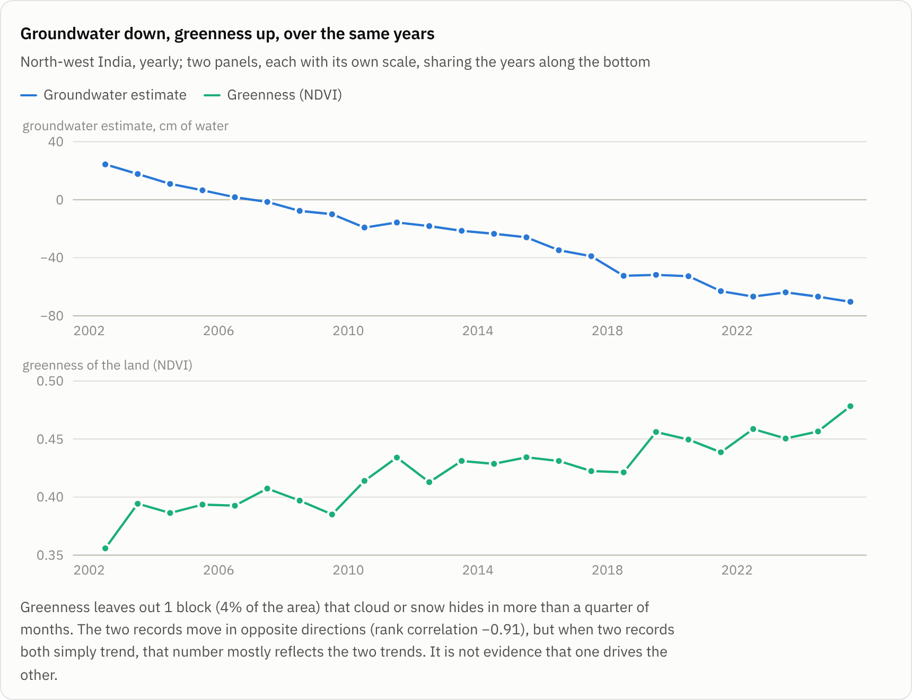

Here is how it got there, one question at a time. Questions 1 to 6 are the six steps of one playbook, and each
step is one procedure. Questions 7 and 8 are where the tool stops. Question 9 runs the same playbook somewhere else.

**[Open the interactive version](https://stayingfoolish.github.io/timedetective/story/)** to hover over any chart and see the numbers behind it, or run it
live with `make demo`, which opens on this walkthrough.

### 1. How can anyone know what is underground?

By weighing it from orbit. Two satellite missions, GRACE and then GRACE-FO, run by NASA with German partners,
measure tiny changes in Earth's gravity as water moves around. That gives the change in all the water stored in a
region. A NASA land model, GLDAS, estimates the soil moisture and snow. Subtract that, and what is left is an
estimate of groundwater, counted in centimetres of water: a layer that deep spread over the whole region.

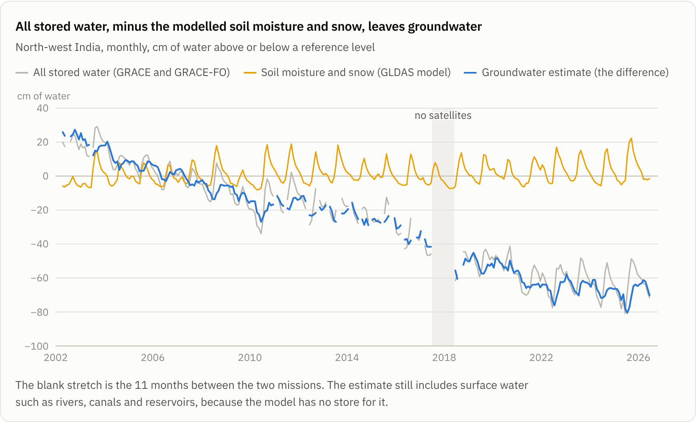

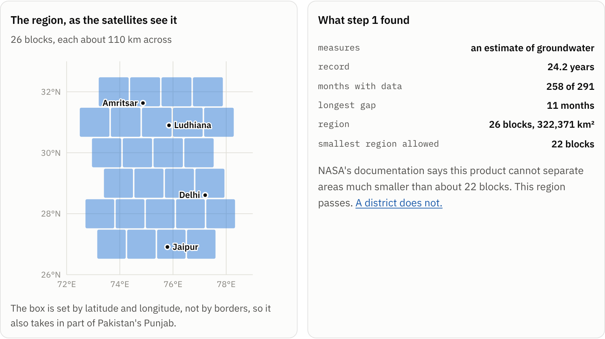

**Step 1 of 6** · [`storage_audit`](knowledge/procedures/diagnostics/storage_audit.yaml) · rule from [NASA's mascon documentation](https://earth.gsfc.nasa.gov/geo/data/grace-mascons) · groundwater estimate, 24.2 years, 258 of 291 months, 26 blocks (22 needed) → **ok**

### 2. Is it actually falling?

Yes. With the yearly cycle of monsoon and dry season removed and each year averaged, the estimate goes from
+24 cm in 2002 to −65 cm in 2026.

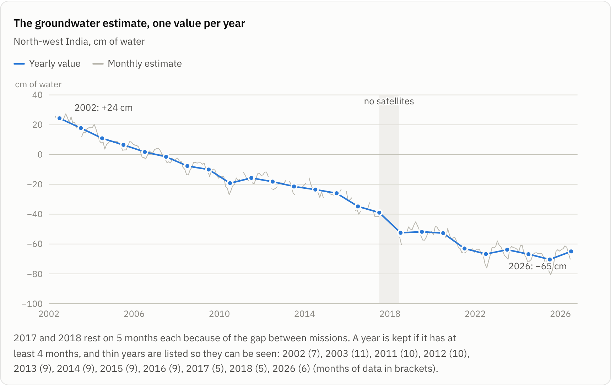

**Step 2 of 6** · [`storage_annual`](knowledge/procedures/transforms/storage_annual.yaml) · rule from [the project's written policy](docs/story_playbooks.md) · 25 yearly values, 2002 to 2026 → **ok**

### 3. Is that real, or could it be noise?

It is larger than chance would explain. A fitted line cannot answer this, because a line can be fitted to
anything, and records like this one wander: a wet year leaves the ground wetter the next year too, so a record with
no trend can drift one way for a decade. The test used here ignores the line. It takes the change from each year to
the next and asks whether those changes average out to zero.

They do not. The average is a fall of 3.7 cm a year, nearly as large as the usual swing from one year to
the next (4.4 cm), and the test's p-value is 0.004.

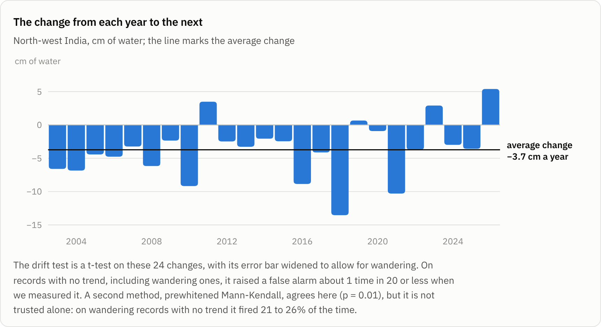

**Step 3 of 6** · [`storage_trend`](knowledge/procedures/trend/storage_trend.yaml) · rule from [the project's written policy](docs/story_playbooks.md) · −4.0 cm a year, drift test p = 0.004 → **ok**

### 4. Could it be the satellites and not the water?

The check finds no clear sign of it, though this is the closest call here. The record comes from two missions with
11 months between them, and a small offset between them would look like a decline. Step 4 measures the
change across that gap, after taking out the overall slide, and compares it with every other stretch of the same
length. 21 of 233 stretches (9%) moved as much. The bar for raising a caution is 1 in 20, and
this does not pass it.

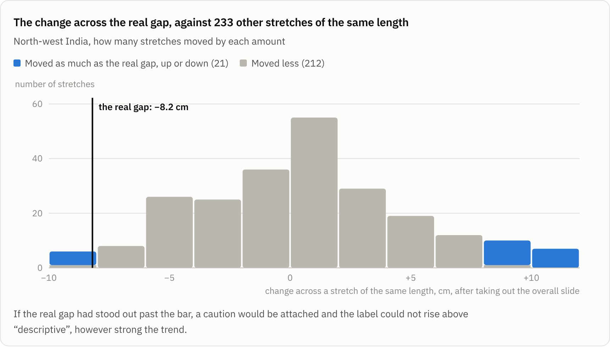

**Step 4 of 6** · [`storage_handover`](knowledge/procedures/changepoint/storage_handover.yaml) · rule from [the project's written policy](docs/story_playbooks.md) · 9% of other stretches moved as much (the bar is 5%), no caution → **ok**

### 5. Is it just a dry spell?

No. Rainfall rose over the period, and the water still fell. In a spell of exactly average rainfall, storage still
fell about 4.1 cm a year (range 2.4 to 5.8).

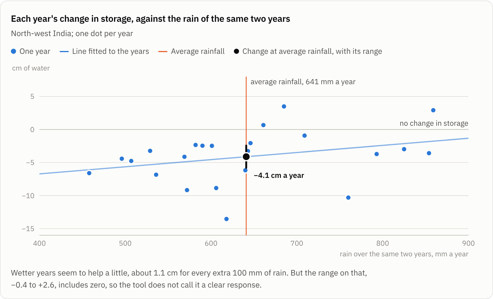

**Step 5 of 6** · [`storage_rainfall`](knowledge/procedures/relationship/storage_rainfall.yaml) · rule from [Rodell et al. 2009](https://escholarship.org/content/qt22577805/qt22577805.pdf) · −4.1 cm a year at average rainfall → **ok**

### 6. Would you see it from the fields?

No. This is the chart at the top: over 2002 to 2025 the land got greener, by about 0.04 NDVI a
decade, while the water under it fell. NDVI is a satellite measure of green plant cover, from NASA's MODIS
instrument.

**Step 6 of 6** · [`storage_greenness`](knowledge/procedures/relationship/storage_greenness.yaml) · rule from [Asoka & Mishra 2020](https://arxiv.org/abs/1908.00255) · pattern: greener while storage fell → **finding**

### 7. So why is it falling?

TimeDetective does not say. Asked why, it runs the same six steps and adds two sentences to the finding:

> The question asks about a cause; this check does not identify causes.
>
> Fields staying green while stored water falls is the pattern a reference study of north-west India links to pumping for irrigation; this check shows the two records side by side and does not test that cause.

The 2009 study in Nature by Rodell, Velicogna and Famiglietti concluded that pumping for irrigation was the likely
cause. That is their conclusion. Testing it needs pumping records, and no step in this playbook has any. A tool
that printed "caused by irrigation" here would be repeating a paper, not checking one.

### 8. What about my district?

It refuses, at the first step, before any trend is computed. A district such as Ludhiana is smaller than one
of the satellites' blocks, and even 3 blocks cannot be separated from the land around them.

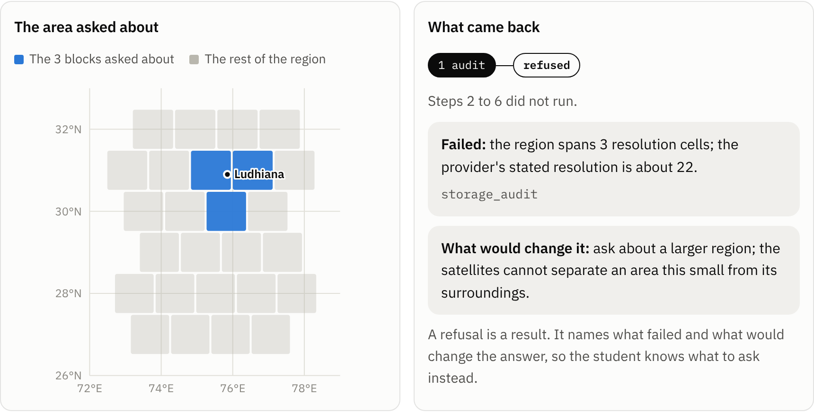

### 9. Is it the same in Kansas?

Same six steps, different label. Over the US High Plains a straight line falls about 1.3 cm a year (range
0.9 to 1.7), but the test does not fire (p = 0.06), so the tool reports the slope as a description and says a
record that simply wanders could look like this. There the average yearly fall (1.5 cm) is about half the
usual swing (2.8 cm).

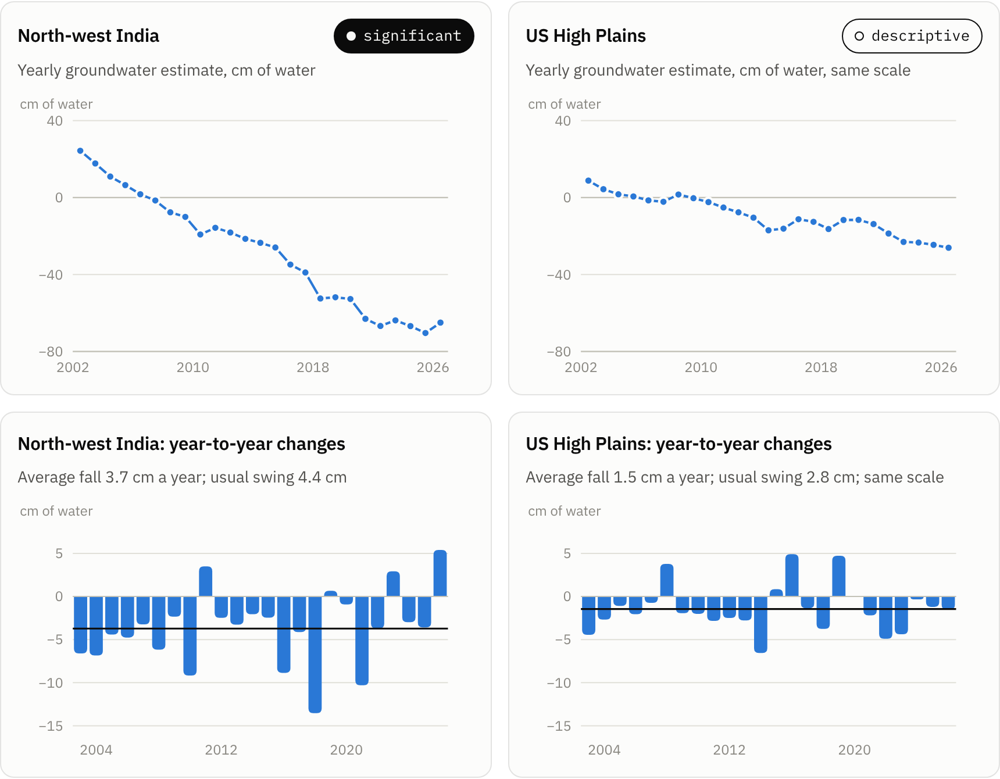

A widely used test, prewhitened Mann-Kendall, does fire here (p = 0.002). It also fired on 21 to 26% of
wandering records with no trend when we measured it, so it does not get to decide. The strictness has a price: the
tool will sometimes hold back on a decline that is real.

### How the label was decided

Procedures never choose the label. They record evidence, and one module, the critic, applies a fixed rule to it.

| What the critic reads | North-west India | US High Plains |
| --- | --- | --- |
| *Needed for “significant”* | | |
| The test used is one whose false-alarm rate has been measured | ✓ drift test | ✓ drift test |
| The test fired (p under 0.05) | ✓ p = 0.004 | ✗ p = 0.06 |
| The record length is in the range the test was measured on (20 to 30 years) | ✓ 25 years | ✓ 25 years |
| One year's change does not copy the last too closely (correlation 0.5 or less) | ✓ −0.16 | ✓ +0.12 |
| The slope is larger than the smallest steady trend this record could detect | ✓ 4.0 against 0.6 | ✓ 1.3 against 0.5 |
| No caution about the instruments was raised | ✓ none | ✓ none |
| *Also needed for “robust”* | | |
| The direction holds when the first or last years are dropped | ✓ holds | ✓ holds |
| A second method gives the same verdict | ✓ agrees | ✗ disagrees |
| An independent record, such as wells, agrees | ✗ not compared | ✗ not compared |
| **Label** | **significant** | **descriptive** |

### The playbook and its procedures

The order of the six steps is a data file, [`knowledge/playbooks/water_and_greenness_check.yaml`](knowledge/playbooks/water_and_greenness_check.yaml). Every arrow in it names the
source of the rule that justifies it, and the engine rejects an arrow that has none.

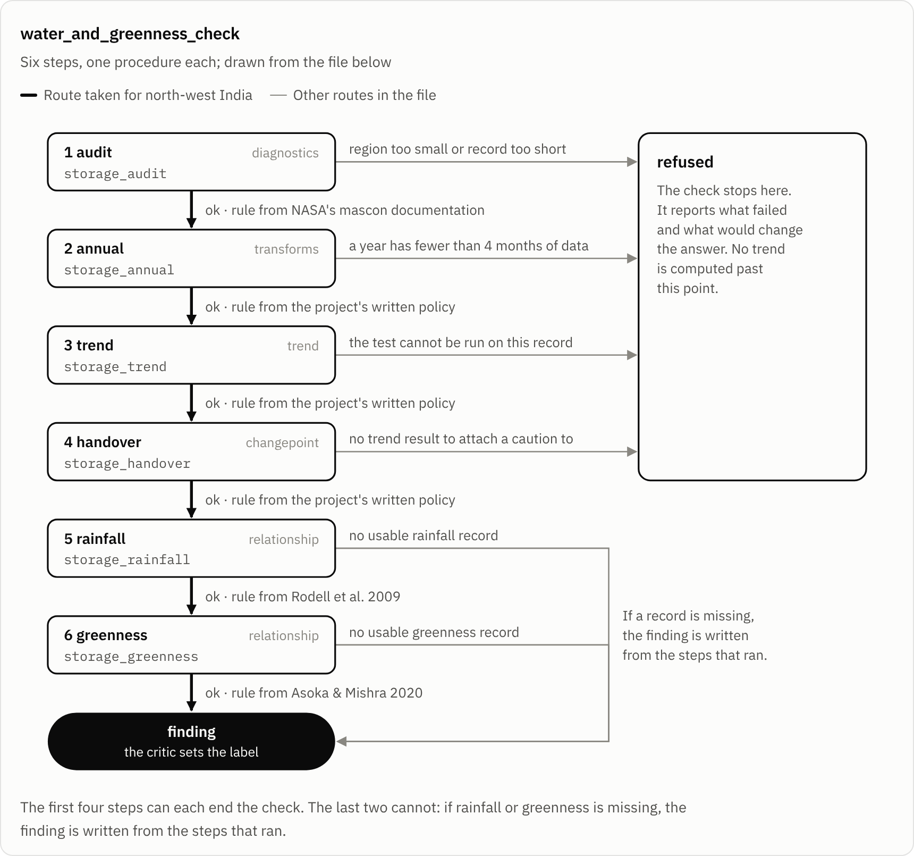

| Step | Procedure | What it does | Rule from |
| --- | --- | --- | --- |
| 1 | [`storage_audit`](knowledge/procedures/diagnostics/storage_audit.yaml) | Checks where the data came from, what it measures, whether the region is large enough for the satellites to resolve, and whether the record is long enough. | [NASA's mascon documentation](https://earth.gsfc.nasa.gov/geo/data/grace-mascons) |
| 2 | [`storage_annual`](knowledge/procedures/transforms/storage_annual.yaml) | Removes the yearly cycle and averages each calendar year. A year is kept if it has at least 4 months of data, and thin years are listed. | [the project's written policy](docs/story_playbooks.md) |
| 3 | [`storage_trend`](knowledge/procedures/trend/storage_trend.yaml) | Fits the slope and its range, runs the drift test on the year-to-year changes, and records the checks the label will depend on. | [the project's written policy](docs/story_playbooks.md) |
| 4 | [`storage_handover`](knowledge/procedures/changepoint/storage_handover.yaml) | Measures the change across the gap between the two missions and ranks it against the same measurement everywhere else in the record. | [the project's written policy](docs/story_playbooks.md) |
| 5 | [`storage_rainfall`](knowledge/procedures/relationship/storage_rainfall.yaml) | Sets each year's change in storage against the rain of the same two years, and reads off the change at average rainfall. | [Rodell et al. 2009](https://escholarship.org/content/qt22577805/qt22577805.pdf) |
| 6 | [`storage_greenness`](knowledge/procedures/relationship/storage_greenness.yaml) | Puts yearly greenness beside yearly storage over the same years and names the pattern. | [Asoka & Mishra 2020](https://arxiv.org/abs/1908.00255) |

Each procedure is a short definition file plus one function that does the arithmetic. No AI model runs inside any
of them.

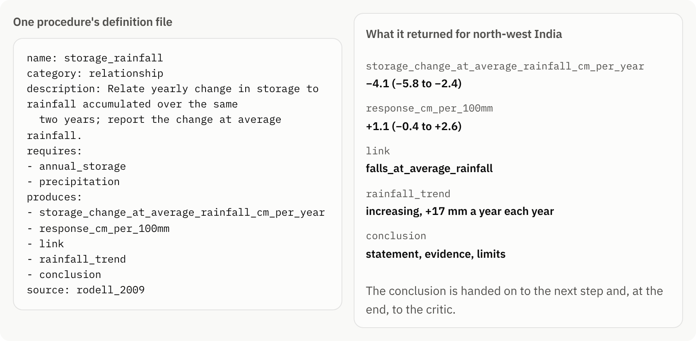

Every figure in this walkthrough is written out by the code: `uv run python scripts/story/extract.py`, then
`uv run python scripts/story/build_page.py`.
<!-- story:end -->

## The problem

Draw a line through satellite data and you might have found a trend. Or a wandering short record, a sensor change,
or a few wet years dressed up as a recovery. For a district agriculture officer or groundwater manager, telling
those stories apart matters.

TimeDetective does the statistician's part. It runs expert checks in a deliberate order and labels the answer by
how much evidence supports it. If the record cannot settle the question, the answer explains why and what would
help.

## Three real answers

All three use real NASA records. The words in the middle column are the tool's own.

| Who is asking | What the tool says | Claim strength |
| --- | --- | --- |
| **Harpreet**, a water officer in Punjab: *is the water under these farms running out, and would the fields show it?* | "Groundwater storage in this region fell by about 4.0 cm of water per year between 2002 and 2026 (range 3.6 to 4.4), about 95 cm in total. In a spell of average rainfall, storage still fell by about 4.1 cm a year, so rainfall alone does not account for the decline. […] Over the same years (2002-2025) the region grew greener, by about 0.04 NDVI a decade. Looking at the fields alone, nothing would suggest the water under them was falling." | Significant |
| **Maria**, a groundwater manager in western Kansas: *the same question for the High Plains* | "On a straight-line fit, groundwater storage in this region fell by about 1.3 cm of water per year. Year-to-year changes vary too much for that to pass this project's significance test: a record that simply wanders could look like this." | Descriptive |
| **Grace**, a district agriculture officer in Karamoja, Uganda: *how does this growing season compare?* | For 2009: "Vegetation greenness in the 2009 season was well below usual: lowest of 27 seasons. Rainfall agrees: rainfall for the matching months was well below usual (lowest of 26 seasons)." | Descriptive |

The personas are composites. The numbers are not: see [the full results](docs/story_results.md) and the screenshots
for [north-west India](docs/images/groundwater_north_west_india.png), the [High Plains](docs/images/groundwater_high_plains.png),
[Karamoja 2009](docs/images/crop_2009.png) and [Karamoja 2026](docs/images/crop_2026.png).

Both checks stop at information. They make no forecast, name no cause and declare nothing.

## How it works

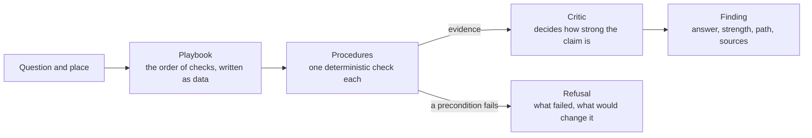

The loop is agentic in structure: the executor walks the playbook, the outcome of each step decides the next
one, and the critic reviews the recorded evidence before any claim is made. The planner and the narrator are the
two places reserved for a language model. In this release both are deterministic, so no AI model runs when a check
executes.

Every finding carries one of three labels, and only the critic can assign it:

| Label | Meaning |
| --- | --- |
| Descriptive | What the record shows, with a size and a range. |
| Significant | A test with a measured false-alarm rate fired, inside the conditions it was checked for. |
| Robust | Significant, and it survives a second method and an independent record. |

A refusal is a result, not an error. Ask about a region too small for the satellites to resolve and the answer is
"ask about a larger region; the satellites cannot separate an area this small from its surroundings".

### A playbook, as data

Trimmed and annotated from [`knowledge/playbooks/water_storage_check.yaml`](knowledge/playbooks/water_storage_check.yaml). A playbook
is the order of checks an expert would run. Every arrow names the source that justifies it.

```yaml
name: water_storage_check
question: Is the water stored in and under this region changing, and does the change follow rainfall?
start: audit
nodes:
  - {id: audit,    procedure: storage_audit}      # is the region big enough, the record long enough?
  - {id: annual,   procedure: storage_annual}     # yearly values across the gap between satellite missions
  - {id: trend,    procedure: storage_trend}      # slope, range, and the drift test
  - {id: handover, procedure: storage_handover}   # did something odd happen when the satellites changed?
  - {id: rainfall, procedure: storage_rainfall}   # does the change follow rainfall?
  - {id: described, terminal: claim}
  - {id: refused,   terminal: refusal}
edges:
  - {origin: audit, target: annual,  outcome: ok,      source: gsfc_mascon_format}
  - {origin: audit, target: refused, outcome: refused, source: gsfc_mascon_format}
  - {origin: rainfall, target: described, outcome: ok, source: rodell_2009}
```

### A procedure: the drift test

A procedure is one deterministic check with a written definition and a source. This one decides whether a change
can be called significant. Definition: [`knowledge/procedures/trend/drift_test.yaml`](knowledge/procedures/trend/drift_test.yaml).

```yaml
name: drift_test
category: trend
description: t-test on the average step-to-step change, with the standard error inflated for
  autocorrelation in the changes and a floor that covers a period-averaged random walk.
requires: [regular_spacing, no_missing]
produces: [trend_detected, p_value, mean_change, lag1_of_changes]
source: drift_test_note_v1
```

The calculation, simplified from [`src/timedetective/skills/trend/drift.py`](src/timedetective/skills/trend/drift.py):

```python
d = np.diff(x)                                   # yearly changes
rho = min(max(lag1(d), 0.25), 0.8)               # never assume the changes are independent
se = d.std(ddof=1) / np.sqrt(len(d)) * np.sqrt((1 + rho) / (1 - rho))
p = 2 * student_t.sf(abs(d.mean() / se), len(d) - 1)
```

It asks whether the average yearly change differs from zero, given how much the yearly changes vary. The 0.25 is
not a tuning knob: it is the correlation that averaging a wandering record over each year puts into its yearly
changes, derived and tested in [docs/drift_test.md](docs/drift_test.md).

On the real records: north-west India changes by -3.3 cm a year on average, p = 0.018, so the test fires. The High
Plains changes by -1.5 cm a year, p = 0.12, so it does not, and the finding stays descriptive.

### Regime change: did the record itself shift?

Before ranking a growing season, the tool has to know whether "usual" has moved. Two procedures answer that together.

[`pelt`](knowledge/procedures/changepoint/pelt.yaml) uses the [ruptures](https://centre-borelli.github.io/ruptures-docs/)
library to find where the level of a record shifts, however many times. On 27 seasons of greenness around Kotido it
finds one shift, in 2012:

```python
>>> pelt(seasons).values
{'n_changes': 1, 'change_times': [2012], 'shifts': [0.093],
 'segments': [{'start': 2000, 'end': 2011, 'mean': 0.361}, {'start': 2012, 'end': 2026, 'mean': 0.454}], ...}
```

That is a candidate, not a verdict. `pelt` assumes the level is flat between shifts, so it turns any steady slide
into a staircase: on the north-west India water record it reports three "shifts" in what is one steady decline.
So [`step_vs_trend`](knowledge/procedures/changepoint/step_vs_trend.yaml) asks which description fits better
(lower score is better):

| Description of the Kotido record | Score (BIC) |
| --- | --- |
| No change | -146.2 |
| One step up, in 2012 | **-160.7** |
| A steady rise | -159.7 |
| A step and a rise | -157.9 |

Both a step and a steady rise beat "no change" clearly, and they are nearly tied with each other. The season check
therefore does not announce a regime shift in 2012. It reports that the record drifts, gives each season's rank both
ways, and says "usual is a moving reference". For 2026 that matters: the season is ordinary against the whole
record and the lowest against the drift.

(The output above is abbreviated, with dates shown as years. The season check itself runs `step_vs_trend`; `pelt` is
in the library for records with more than one shift.)

## What is different

- **The label is earned.** "Significant" is only available from a test whose false-alarm rate we measured.
- **A refusal is an answer.** Too small a region, too short a record, a missing month: each stops the check with a reason.
- **Every step cites a source.** A paper, a provider's documentation, or a written house rule that someone opened and read. A procedure whose paper has not been opened is marked `TODO` and cannot be used in a playbook.
- **The method is data.** Playbooks and procedure definitions are YAML that a domain expert can read and change.
- **The core is not about Earth.** The engine and 62 general procedures work on any time series; the 24 Earth-specific ones live in a pack.

## NASA data used

| Dataset | Used for | Source |
| --- | --- | --- |
| GRACE and GRACE-FO mascons (NASA GSFC, RL06v2.0), April 2002 to June 2026 | Water stored on and under the land, for two regions | [GSFC mascons](https://earth.gsfc.nasa.gov/geo/data/grace-mascons) |
| GLDAS Noah land surface model, monthly V2.1, 2002 to July 2026 | Modelled soil moisture, snow and canopy water, subtracted from GRACE to estimate groundwater | [GES DISC](https://disc.gsfc.nasa.gov/datasets/GLDAS_NOAH025_M_2.1/summary), Earthdata Cloud OPeNDAP |
| MODIS Terra monthly vegetation index, MOD13C2, 2000 to December 2025 | Greenness over each water-storage region | [LP DAAC](https://doi.org/10.5067/MODIS/MOD13C2.061), Earthdata Cloud OPeNDAP |
| MODIS Terra vegetation index, MOD13Q1, 2000 to October 2026 | Greenness of the growing season around Kotido | [ORNL DAAC subset service](https://modis.ornl.gov/data/modis_webservice.html) |
| IMERG satellite rainfall, via NASA POWER | Second indicator for the season check | [NASA POWER](https://power.larc.nasa.gov/) |
| MERRA-2 corrected rainfall and soil wetness, via NASA POWER | Rainfall over each water-storage region; a second rainfall product | [NASA POWER](https://power.larc.nasa.gov/) |

Every cached file sits in `data/cache/earth/stories/` beside a sidecar with its request address, retrieval date and
checksum. The loaders refuse a file whose checksum does not match.

## How we know it is right

- **False alarms are measured.** On synthetic records with no trend, built to copy the real record's length and
  gaps, the water storage check calls at most 5.2% "significant". That includes records that wander like a random
  walk. Tables are in [docs/calibration.md](docs/calibration.md).
- **We threw out our own first test.** The first version used a well-known trend test and reported "no detectable
  trend" for north-west India, where storage fell about 85 cm. Chasing that showed the test also cries wolf on 21% to
  26% of wandering records. We replaced it and wrote down what changed and why in
  [docs/story_playbooks.md](docs/story_playbooks.md). One consequence: the High Plains lost its "significant" label.
- **It agrees with the literature where it should.** Over August 2002 to October 2008 total water storage in
  north-west India falls 4.7 cm a year and the groundwater estimate 5.3; Rodell et al. (2009) report 4.0 ± 1.0 cm a
  year of groundwater loss for that period. The outlines and data releases differ, so this is a plausibility check,
  not a validation.
- **It agrees with the ground where it should.** The season it ranks lowest around Kotido, 2009, is one in which an
  official in Karamoja told reporters that crops had dried up with no harvest
  ([VOA, November 2009](https://www.voanews.com/a/a-13-2009-11-04-voa39-69781372/415417.html)).
- **313 automated tests**, including known-answer tests for every procedure and tests that pin the real results.

## What it cannot do yet

- **Groundwater exactly.** Groundwater is estimated by subtracting modelled soil moisture, snow and canopy water
  (GLDAS) from total storage. Surface water (lakes, rivers, reservoirs, canals) is not subtracted; every finding says so.
- **Crops alone.** The season check reads all vegetation in a 10 km box. It has no cropland mask.
- **"Robust".** No finding can reach the top label until an independent record, such as observation wells, is wired in.
- **Any place.** Three places are cached for these two checks. A new place needs its data fetched; the checks themselves are not tied to these three.
- **Choosing the check for you.** You pick the check and the place. The question text is recorded and screened for
  things the check will not answer, such as causes and forecasts.
- **The newest vegetation reading.** The MODIS satellite is near the end of its life; the 2026 reading should be
  checked against a second sensor.

## Try it

```bash
git clone https://github.com/stayingfoolish/timedetective.git
cd timedetective
uv sync
make demo
```

The demo opens in a wide, screen-recording-friendly groundwater story. Each clue puts its chart and takeaway side
by side, with the question, controls and current evidence on one screen at desktop size. Use **Next clue** to follow
six checks to the evidence label. Open **Change the question or area** to try *why is the groundwater falling here?*,
switch to the US High Plains, or pick an area too small for the satellites to resolve. Open the complete evidence
trail for the playbook and every recorded step. The answer changes with the evidence.

Select **Research tools** at the top for the season check, total-storage check and weather explorer. The automatic
precipitation investigator lets you preview the request before fetching NASA POWER data, then follow the data,
checks and answer in stages. The worked groundwater and season examples use the cached NASA files.

```bash
make test                                                   # 313 tests
uv run python scripts/validate_knowledge.py --scope stories # the story playbooks and their sources
```

## Use of AI

- Much of the code, tests and documentation in this repository was written with an AI coding assistant (Claude,
  by Anthropic), directed and reviewed by the team. Commits made by the assistant are marked `Co-Authored-By` in the
  git history.
- No AI model runs when a check executes. Every procedure is deterministic, and the wording of a finding is
  assembled from templates and recorded values.
- No data was generated by AI. All records are NASA products, cached with checksums. Synthetic series are used only
  in tests and calibration and are labelled as synthetic.
- The screenshots are captures of the running app, and the charts in the walkthrough are drawn from the run output
  by the code in `scripts/story/`. There are no AI-generated images.

## Team, licence and references

**Team:** PJ and Amrit Sreekumar.

**Licence:** MIT.

**Sources opened for the methods:** Rodell, Velicogna and Famiglietti (2009), *Nature* 460; the ASAP warning
classification report, v4.0 (European Commission JRC); the NASA GSFC mascon format description; the MOD13 user
guide; the ORNL DAAC subset service documentation; the NASA POWER documentation; Cowles (1960), *Econometrica* 28;
Schwarz (1978); the ruptures documentation. The full list, with what was read in each, is [`knowledge/sources.yaml`](knowledge/sources.yaml).

**Other tools:** Python, pandas, NumPy, SciPy, statsmodels, pymannkendall, ruptures, LinkML, pydantic, Streamlit, uv.

**More:** [results on real data](docs/story_results.md) · [method and house rules](docs/story_playbooks.md) ·
[calibration](docs/calibration.md) · [the drift test](docs/drift_test.md) ·
[project status and developer notes](docs/status.md) · [CONTRIBUTING](CONTRIBUTING.md) · [AGENTS](AGENTS.md)
