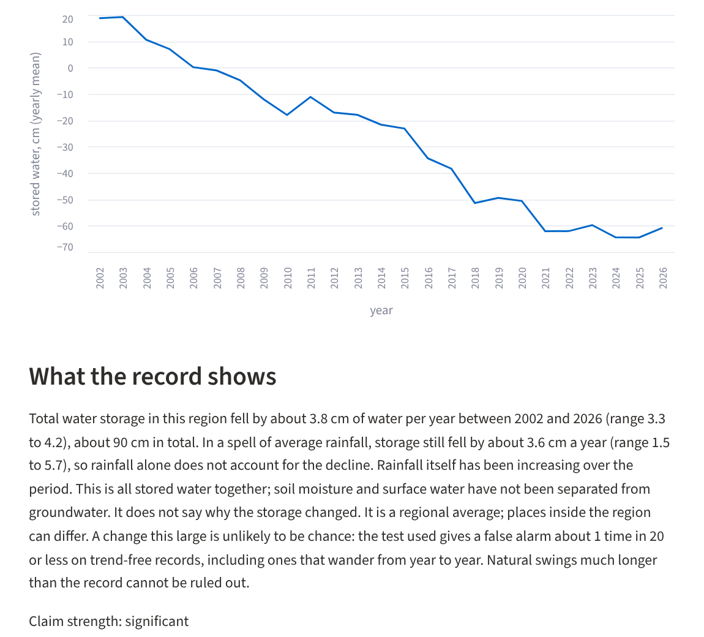
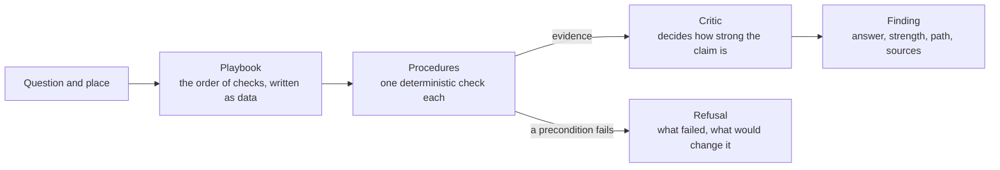

# TimeDetective

**Is it a real trend, or just noise? TimeDetective answers from NASA data, and never claims more than the evidence supports.**

**What it is.** TimeDetective is an open-source tool for questions about how a place is changing: *is the water
under this region disappearing? how does this growing season compare with earlier ones?* It runs the checks a
statistician would run on NASA satellite records and gives the answer in plain words, with a label for how sure it
is: descriptive, significant or robust. When the evidence is not enough, it says so, and says what would be.

**How it does it.** Each kind of question has a *playbook*: the order of checks an expert would run, written down
as data, with a source for every step. Each check is a *procedure*: one small, repeatable calculation, such as a
trend test or a search for the point where a record shifts. A separate *critic* then reads the evidence and decides
the label, so no test can promote its own result. If a check cannot be run honestly, because the region is too
small or the record too short, the tool stops and says why. No AI model takes part in producing an answer.
[More below](#how-it-works).

**The challenge.** Built for the 2026 NASA Space Apps Challenge, *Be an Earth System Trend Detective*. The challenge
asks teams to help people become data detectives: choose an Earth science variable, get its data for a region, plot
it over a long enough period, measure how fast it is changing, and test whether that trend is significant.
TimeDetective does this for water storage, vegetation greenness and rainfall, and adds the step that is easiest
to get wrong: deciding when a trend has earned the word "significant".

Demo: _add the video or slides link here before submitting_

## One real answer

A student reads that north-west India is running out of water and wants to check. TimeDetective takes 24 years of
data from NASA's GRACE satellites, which measure changes in the weight of water on and under the land, and answers
in plain words, with a label for how sure it is.



- **What it found:** water storage fell about 3.8 cm a year, about 90 cm in all, and rainfall does not account for it.
- **How sure it is:** "significant", a label the tool only gives when a test with a measured false-alarm rate fires.
- **What it will not say:** why. It does not name pumping, irrigation or climate, because the record cannot show that.

Ask the same question about the US High Plains and the answer changes: the tool reports a decline of about 1.4 cm a
year but declines to call it significant, because a record that simply wanders could look the same.

## The problem

Anyone can draw a line through satellite data and announce a trend. Many of those trends are not real: short
records wander, instruments change, a few wet years look like a recovery. The people who most need the answer, a
district agriculture officer or a groundwater manager, have no statistician to tell the difference.

TimeDetective does the statistician's part. It runs the checks an expert would run, in the order an expert would run
them, and labels the answer by how much the evidence supports. When the evidence is not enough, it says so and says
what would be.

## Three real answers

All three use real NASA records. The words in the middle column are the tool's own.

| Who is asking | What the tool says | Claim strength |
| --- | --- | --- |
| **Harpreet**, a water officer in Punjab: *is the water under these farms running out, and would the fields show it?* | "Groundwater storage in this region fell by about 4.0 cm of water per year between 2002 and 2026 (range 3.6 to 4.4), about 95 cm in total. In a spell of average rainfall, storage still fell by about 4.1 cm a year, so rainfall alone does not account for the decline. […] Over the same years (2002-2025) the region grew greener, by about 0.04 NDVI a decade. Looking at the fields alone, nothing would suggest the water under them was falling." | Significant |
| **Maria**, a groundwater manager in western Kansas: *the same question for the High Plains* | "On a straight-line fit, groundwater storage in this region fell by about 1.3 cm of water per year. Year-to-year changes vary too much for that to pass this project's significance test: a record that simply wanders could look like this." | Descriptive |
| **Grace**, a district agriculture officer in Karamoja, Uganda: *how does this growing season compare?* | For 2009: "Vegetation greenness in the 2009 season was well below usual: lowest of 27 seasons. Rainfall agrees: rainfall for the matching months was well below usual (lowest of 26 seasons)." | Descriptive |

The personas are composites. The numbers are not: see [the full results](docs/story_results.md) and the screenshots
for [north-west India](docs/images/groundwater_north_west_india.png), the [High Plains](docs/images/groundwater_high_plains.png),
[Karamoja 2009](docs/images/crop_2009.png) and [Karamoja 2026](docs/images/crop_2026.png).

Both checks stop at information. They make no forecast, name no cause and declare nothing.

## How it works



Every finding carries one of three labels, and only the critic can assign it:

| Label | Meaning |
| --- | --- |
| Descriptive | What the record shows, with a size and a range. |
| Significant | A test with a measured false-alarm rate fired, inside the conditions it was checked for. |
| Robust | Significant, and it survives a second method and an independent record. |

A refusal is a result, not an error. Ask about a region too small for the satellites to resolve and the answer is
"ask about a larger region; the satellites cannot separate an area this small from its surroundings".

### A playbook, as data

Trimmed and annotated from [`knowledge/playbooks/water_storage_check.yaml`](knowledge/playbooks/water_storage_check.yaml). A playbook
is the order of checks an expert would run. Every arrow names the source that justifies it.

```yaml
name: water_storage_check
question: Is the water stored in and under this region changing, and does the change follow rainfall?
start: audit
nodes:
  - {id: audit,    procedure: storage_audit}      # is the region big enough, the record long enough?
  - {id: annual,   procedure: storage_annual}     # yearly values across the gap between satellite missions
  - {id: trend,    procedure: storage_trend}      # slope, range, and the drift test
  - {id: handover, procedure: storage_handover}   # did something odd happen when the satellites changed?
  - {id: rainfall, procedure: storage_rainfall}   # does the change follow rainfall?
  - {id: described, terminal: claim}
  - {id: refused,   terminal: refusal}
edges:
  - {origin: audit, target: annual,  outcome: ok,      source: gsfc_mascon_format}
  - {origin: audit, target: refused, outcome: refused, source: gsfc_mascon_format}
  - {origin: rainfall, target: described, outcome: ok, source: rodell_2009}
```

### A procedure: the drift test

A procedure is one deterministic check with a written definition and a source. This one decides whether a change
can be called significant. Definition: [`knowledge/procedures/trend/drift_test.yaml`](knowledge/procedures/trend/drift_test.yaml).

```yaml
name: drift_test
category: trend
description: t-test on the average step-to-step change, with the standard error inflated for
  autocorrelation in the changes and a floor that covers a period-averaged random walk.
requires: [regular_spacing, no_missing]
produces: [trend_detected, p_value, mean_change, lag1_of_changes]
source: drift_test_note_v1
```

The calculation, simplified from [`src/timedetective/skills/trend/drift.py`](src/timedetective/skills/trend/drift.py):

```python
d = np.diff(x)                                   # yearly changes
rho = min(max(lag1(d), 0.25), 0.8)               # never assume the changes are independent
se = d.std(ddof=1) / np.sqrt(len(d)) * np.sqrt((1 + rho) / (1 - rho))
p = 2 * student_t.sf(abs(d.mean() / se), len(d) - 1)
```

It asks whether the average yearly change differs from zero, given how much the yearly changes vary. The 0.25 is
not a tuning knob: it is the correlation that averaging a wandering record over each year puts into its yearly
changes, derived and tested in [docs/drift_test.md](docs/drift_test.md).

On the real records: north-west India changes by -3.3 cm a year on average, p = 0.018, so the test fires. The High
Plains changes by -1.5 cm a year, p = 0.12, so it does not, and the finding stays descriptive.

### Regime change: did the record itself shift?

Before ranking a growing season, the tool has to know whether "usual" has moved. Two procedures answer that together.

[`pelt`](knowledge/procedures/changepoint/pelt.yaml) uses the [ruptures](https://centre-borelli.github.io/ruptures-docs/)
library to find where the level of a record shifts, however many times. On 27 seasons of greenness around Kotido it
finds one shift, in 2012:

```python
>>> pelt(seasons).values
{'n_changes': 1, 'change_times': [2012], 'shifts': [0.093],
 'segments': [{'start': 2000, 'end': 2011, 'mean': 0.361}, {'start': 2012, 'end': 2026, 'mean': 0.454}], ...}
```

That is a candidate, not a verdict. `pelt` assumes the level is flat between shifts, so it turns any steady slide
into a staircase: on the north-west India water record it reports three "shifts" in what is one steady decline.
So [`step_vs_trend`](knowledge/procedures/changepoint/step_vs_trend.yaml) asks which description fits better
(lower score is better):

| Description of the Kotido record | Score (BIC) |
| --- | --- |
| No change | -146.2 |
| One step up, in 2012 | **-160.7** |
| A steady rise | -159.7 |
| A step and a rise | -157.9 |

Both a step and a steady rise beat "no change" clearly, and they are nearly tied with each other. The season check
therefore does not announce a regime shift in 2012. It reports that the record drifts, gives each season's rank both
ways, and says "usual is a moving reference". For 2026 that matters: the season is ordinary against the whole
record and the lowest against the drift.

(The output above is abbreviated, with dates shown as years. The season check itself runs `step_vs_trend`; `pelt` is
in the library for records with more than one shift.)

## What is different

- **The label is earned.** "Significant" is only available from a test whose false-alarm rate we measured.
- **A refusal is an answer.** Too small a region, too short a record, a missing month: each stops the check with a reason.
- **Every step cites a source.** A paper, a provider's documentation, or a written house rule that someone opened and read. A procedure whose paper has not been opened is marked `TODO` and cannot be used in a playbook.
- **The method is data.** Playbooks and procedure definitions are YAML that a domain expert can read and change.
- **The core is not about Earth.** The engine and 62 general procedures work on any time series; the 23 Earth-specific ones live in a pack.

## NASA data used

| Dataset | Used for | Source |
| --- | --- | --- |
| GRACE and GRACE-FO mascons (NASA GSFC, RL06v2.0), April 2002 to June 2026 | Water stored on and under the land, for two regions | [GSFC mascons](https://earth.gsfc.nasa.gov/geo/data/grace-mascons) |
| GLDAS Noah land surface model, monthly V2.1, 2002 to July 2026 | Modelled soil moisture, snow and canopy water, subtracted from GRACE to estimate groundwater | [GES DISC](https://disc.gsfc.nasa.gov/datasets/GLDAS_NOAH025_M_2.1/summary), Earthdata Cloud OPeNDAP |
| MODIS Terra monthly vegetation index, MOD13C2, 2000 to December 2025 | Greenness over each water-storage region | [LP DAAC](https://doi.org/10.5067/MODIS/MOD13C2.061), Earthdata Cloud OPeNDAP |
| MODIS Terra vegetation index, MOD13Q1, 2000 to October 2026 | Greenness of the growing season around Kotido | [ORNL DAAC subset service](https://modis.ornl.gov/data/modis_webservice.html) |
| IMERG satellite rainfall, via NASA POWER | Second indicator for the season check | [NASA POWER](https://power.larc.nasa.gov/) |
| MERRA-2 corrected rainfall and soil wetness, via NASA POWER | Rainfall over each water-storage region; a second rainfall product | [NASA POWER](https://power.larc.nasa.gov/) |

Every cached file sits in `data/cache/earth/stories/` beside a sidecar with its request address, retrieval date and
checksum. The loaders refuse a file whose checksum does not match.

## How we know it is right

- **False alarms are measured.** On synthetic records with no trend, built to copy the real record's length and
  gaps, the water storage check calls at most 5.2% "significant". That includes records that wander like a random
  walk. Tables are in [docs/calibration.md](docs/calibration.md).
- **We threw out our own first test.** The first version used a well-known trend test and reported "no detectable
  trend" for north-west India, where storage fell about 85 cm. Chasing that showed the test also cries wolf on 21% to
  26% of wandering records. We replaced it and wrote down what changed and why in
  [docs/story_playbooks.md](docs/story_playbooks.md). One consequence: the High Plains lost its "significant" label.
- **It agrees with the literature where it should.** Over August 2002 to October 2008 the north-west India series falls
  4.7 cm a year; Rodell et al. (2009) report 4.0 ± 1.0 cm a year of groundwater loss for that period. The quantities
  differ, so this is a plausibility check, not a validation.
- **It agrees with the ground where it should.** The season it ranks lowest around Kotido, 2009, is one in which an
  official in Karamoja told reporters that crops had dried up with no harvest
  ([VOA, November 2009](https://www.voanews.com/a/a-13-2009-11-04-voa39-69781372/415417.html)).
- **307 automated tests**, including known-answer tests for every procedure and tests that pin the real results.

## What it cannot do yet

- **Groundwater exactly.** Groundwater is estimated by subtracting modelled soil moisture, snow and canopy water
  (GLDAS) from total storage. Surface water (lakes, rivers, reservoirs, canals) is not subtracted; every finding says so.
- **Crops alone.** The season check reads all vegetation in a 10 km box. It has no cropland mask.
- **"Robust".** No finding can reach the top label until an independent record, such as observation wells, is wired in.
- **Any place.** Three places are cached for these two checks. A new place needs its data fetched; the checks themselves are not tied to these three.
- **Choosing the check for you.** You pick the check and the place. The question text is recorded and screened for
  things the check will not answer, such as causes and forecasts.
- **The newest vegetation reading.** The MODIS satellite is near the end of its life; the 2026 reading should be
  checked against a second sensor.

## Try it

```bash
git clone https://github.com/stayingfoolish/timedetective.git
cd timedetective
uv sync
make demo
```

Scroll to "Two checks for any place the data covers". Press **Check water storage** or **Check the season**. Nothing
is fetched: the demo runs on the cached NASA files.

```bash
make test                                                   # 307 tests
uv run python scripts/validate_knowledge.py --scope stories # the two story playbooks and their sources
```

## Use of AI

- Much of the code, tests and documentation in this repository was written with an AI coding assistant (Claude,
  by Anthropic), directed and reviewed by the team. Commits made by the assistant are marked `Co-Authored-By` in the
  git history.
- No AI model runs when a check executes. Every procedure is deterministic, and the wording of a finding is
  assembled from templates and recorded values.
- No data was generated by AI. All records are NASA products, cached with checksums. Synthetic series are used only
  in tests and calibration and are labelled as synthetic.
- The screenshots are captures of the running app. There are no AI-generated images.

## Team, licence and references

**Team:** PJ and Amrit Sreekumar.

**Licence:** MIT.

**Sources opened for the methods:** Rodell, Velicogna and Famiglietti (2009), *Nature* 460; the ASAP warning
classification report, v4.0 (European Commission JRC); the NASA GSFC mascon format description; the MOD13 user
guide; the ORNL DAAC subset service documentation; the NASA POWER documentation; Cowles (1960), *Econometrica* 28;
Schwarz (1978); the ruptures documentation. The full list, with what was read in each, is [`knowledge/sources.yaml`](knowledge/sources.yaml).

**Other tools:** Python, pandas, NumPy, SciPy, statsmodels, pymannkendall, ruptures, LinkML, pydantic, Streamlit, uv.

**More:** [results on real data](docs/story_results.md) · [method and house rules](docs/story_playbooks.md) ·
[calibration](docs/calibration.md) · [the drift test](docs/drift_test.md) ·
[project status and developer notes](docs/status.md) · [CONTRIBUTING](CONTRIBUTING.md) · [AGENTS](AGENTS.md)
